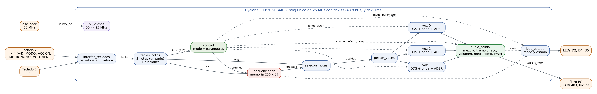

# Sintetizador musical digital en FPGA

Proyecto final de Diseño Digital VLSI (Facultad de Ingeniería, UNAM). Un sintetizador que se toca con dos teclados matriciales, genera las notas por síntesis digital directa (DDS) con envolvente ADSR, graba y reproduce secuencias, tiene metrónomo y suena por una bocina. Toda la lógica está en VHDL sobre una FPGA Cyclone II (tarjeta mínima EP2C5T144); afuera solo hay un filtro RC, un potenciómetro, un amplificador PAM8403 y la bocina.



## Qué hace

- **Teclado:** dos teclados 4 × 4, cada uno con 12 notas cromáticas (dos octavas a la vez) y 4 teclas de función; las del teclado 2 son MODO, ACCIÓN, METRÓNOMO y VOLUMEN. Octava base de 2 a 6.
- **Síntesis:** 3 voces simultáneas, cada una con su acumulador de fase de 24 bits (DDS) y su envolvente ADSR. Formas de onda cuadrada, triangular, sierra y seno.
- **Envolvente ADSR:** 4 tiempos de attack, 4 de decay, 4 niveles de sustain y 4 tiempos de release, modificables en operación.
- **Volumen digital:** 4 niveles más silencio, independiente de la envolvente.
- **Modos:** interpretación, grabación, reproducción y configuración (tecla MODO).
- **Secuenciador:** graba hasta 256 eventos (notas, acordes y silencios con su duración en ms) en una RAM interna y los reproduce con la misma duración.
- **Metrónomo:** 60, 90, 120 y 150 BPM, con acento cada 4 tiempos y un clic que no pasa por los efectos ni el volumen.
- **Efectos:** trémolo y eco (RAM de 4096 muestras, 84 ms).
- **Interfaz:** las teclas de función de los teclados y los 3 LEDs de la tarjeta, que muestran el modo, si graba o reproduce, el tiempo del metrónomo y, en configuración, qué parámetro se cambia.
- **Salida:** PWM de 8 bits a 97.7 kHz, filtro RC de 2 etapas, PAM8403 y bocina de 8 Ω.
- **Reloj:** 25 MHz desde el PLL de la Cyclone II (oscilador de 50 MHz de la tarjeta).

Características de nivel implementadas: polifonía de tres voces y efectos digitales (trémolo y eco). La interfaz VGA se quitó para no necesitar más material.

**Estado:** verificado en simulación (ver [docs/PRUEBAS.md](docs/PRUEBAS.md)); la versión con VGA y botones se compiló en Quartus II 13.0 SP1 para la EP2C5T144C8 (3 782 elementos lógicos, 82 %, reloj de 25 MHz con 12.3 ns de margen) y se cargó en la tarjeta por JTAG. La versión sin VGA, con los controles en el teclado 2, se compila en la TAREA-029. Falta armar la protoboard y probarla con sonido.

## Estructura

| Carpeta | Contenido |
|---|---|
| `rtl/` | VHDL sintetizable (VHDL-93), un módulo por archivo |
| `sim/` | Un testbench por módulo, prueba del sistema completo, modelos y `correr.sh` para GHDL |
| `quartus/` | Scripts que crean y compilan el proyecto, diagrama de bloques del nivel superior (`sintetizador.bdf`), símbolos, PLL (`ip/`), pines, restricciones de tiempo y reportes de la compilación (`reportes/`) |
| `docs/` | Arquitectura y FSM, módulos e interfaces, cableado, materiales, pruebas y diagramas |
| `tools/` | `genera_top.py`, que genera el nivel superior (`.bdf` y `.vhd`) |

## Cómo reproducir

Requisitos: Quartus II 13.0 SP1 Web Edition (la última versión con Cyclone II), un USB-Blaster y GHDL para simular.

```bash
git clone https://github.com/samisal123/robot-seguidor-luz-vlsi.git
cd robot-seguidor-luz-vlsi
sh quartus/compilar.sh     # crea el proyecto, compila y muestra recursos y Fmax
sh quartus/programar.sh    # carga el .sof en la EP2C5T144 por USB-Blaster (JTAG)
sh quartus/grabar_flash.sh # opcional: lo graba en la EPCS4 para que arranque solo
```

`compilar.sh` corre `quartus_sh -t crear_proyecto.tcl` y `quartus_sh --flow compile sintetizador`. Después el proyecto se abre en la interfaz de Quartus con `quartus/sintetizador.qpf`; el nivel superior es el diagrama de bloques `sintetizador.bdf`.

Simulación con GHDL (todos los testbenches, o solo los que se nombren):

```bash
sh sim/correr.sh
sh sim/correr.sh secuenciador adsr
```

## Documentación

- [Arquitectura, módulos y máquinas de estados](docs/ARQUITECTURA.md)
- [Módulos e interfaces: descripción y puertos de cada módulo](docs/MODULOS.md)
- [Cableado: teclados y audio](docs/CABLEADO.md)
- [Materiales](docs/MATERIALES.md)
- [Pruebas: simulación, compilación y pruebas en la tarjeta](docs/PRUEBAS.md)

## Uso rápido

| Control | Función |
|---|---|
| Teclado 2, A: MODO | interpretación → grabación → reproducción → configuración → interpretación |
| Teclado 2, B: ACCIÓN | grabación: iniciar / finalizar; reproducción: iniciar / detener |
| Teclado 2, C: METRÓNOMO | metrónomo encendido / apagado |
| Teclado 2, D: VOLUMEN | siguiente nivel: silencio, 1, 2, 3, 4 |
| Teclado 1, A B C D | octava −, octava +, forma siguiente, efecto siguiente |
| Configuración | teclado 1: A / B cambian el valor, C / D eligen el parámetro (forma, attack, decay, sustain, release, volumen, tempo) |
| RESET (en la tarjeta) | reinicia el sintetizador |

| LEDs | Significado |
|---|---|
| D2 destella | tiempo del metrónomo |
| D4 parpadea / fijo | modo grabación / grabando |
| D5 parpadea / fijo | modo reproducción / reproduciendo |
| Los 3 parpadean rápido | configuración: el número del parámetro en binario (D2 = 1, D4 = 2, D5 = 4) |
