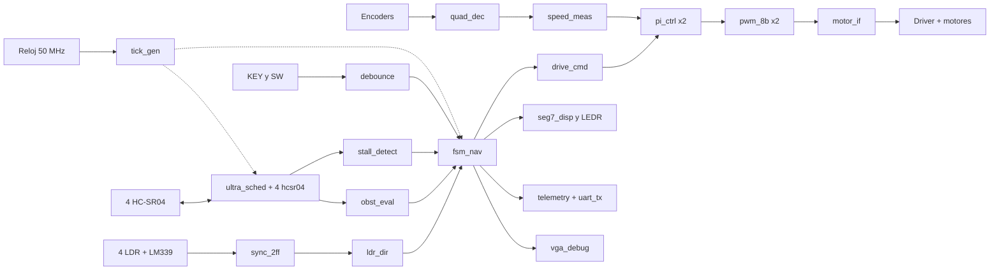
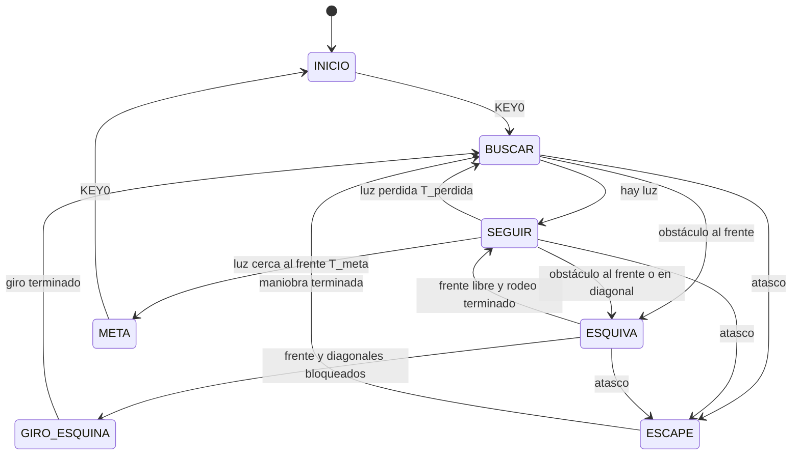

# Arquitectura

## Decisiones de diseño

1. **Un solo reloj.** Todo corre a 50 MHz. Los tiempos lentos (1 µs, 58 µs, 1 ms) salen de pulsos de habilitación de un ciclo generados en `tick_gen`, no de relojes divididos. Así no hay cruces de dominio ni problemas de temporización.
2. **Toda entrada externa pasa por un sincronizador de 2 flip-flops** (LDR, ecos, encoders, botones) antes de usarse.
3. **Parámetros por `generic`:** umbrales de distancia, tiempos de giro, velocidades y N del atasco se ajustan en las pruebas sin reescribir lógica.
4. **Un módulo por archivo y un testbench por módulo.**
5. **Reset síncrono** desde KEY1 (activo en bajo, con debounce). KEY0 arranca el recorrido.

## Diagrama de bloques

Guía para el diagrama oficial, que se arma en el Block Editor de Quartus.

Sin encoders, `drive_cmd` alimenta directo a `pwm_8b` (lazo abierto) y `stall_detect` usa las distancias.

## Módulos

| Módulo | Función | Entradas → salidas principales | Semana |
|---|---|---|---|
| `tick_gen` | Pulsos de 1 µs, 58 µs y 1 ms | clk → tick_1us, tick_58us, tick_1ms | 2 ✔ |
| `sync_2ff` | Sincroniza entradas asíncronas (genérico WIDTH) | d → q | 2 ✔ |
| `debounce` | Filtra botones y switches (20 ms) | raw, tick_1ms → clean, rise, fall | 2 ✔ |
| `pwm_8b` | PWM de 8 bits a 19.53 kHz; el duty nuevo entra al inicio del periodo | duty(7:0) → pwm | 2 ✔ |
| `motor_if` | Dirección y enable para el driver, con pausa de PAUSA_MS (50 ms) al invertir el giro | dir, pwm, tick_1ms → IN1, IN2, EN | 2 ✔ |
| `hcsr04` | Un sensor: pulso TRIG de 10 µs, mide ECHO, timeout de 25 ms | start, echo, tick_1us → trig, dist_cm(8:0), valid, timeout, busy | 2 ✔ |
| `ultra_sched` | Turna los 4 sensores cada 30 ms | ticks → start(3:0), 4 distancias | 2 |
| `ldr_dir` | 4 bits de luz → dirección | ldr(3:0) → dir_luz, hay_luz, luz_cerca | 2 |
| `obst_eval` | Distancias → banderas con histéresis | 4 distancias → obs_f, obs_fi, obs_fd, obs_a | 3 |
| `stall_detect` | Sin avance durante N s | moviendo, distancias o encoders → atasco | 4 |
| `fsm_nav` | FSM principal | banderas → acción, estado, evento | 3 |
| `drive_cmd` | Acción → duty y dirección por rueda | acción → dir_L, duty_L, dir_R, duty_R | 3 |
| `seg7_disp` | Estado, % de duty y eventos en HEX5 a HEX0; distancia con SW9 | estado, evento, duty_l, duty_r, modo_dist, sensor, dist_cm → HEX5..HEX0 | 2 ✔ |
| `telemetry`, `uart_tx` | Bitácora por UART a 115200 baud (opcional) | eventos → tx | 5 |
| `quad_dec`, `speed_meas`, `pi_ctrl` | Extra: velocidad con encoders y PI | A, B → velocidad → duty | 5 |
| `vga_debug` | Extra: tablero de 640 × 480 | estado, sensores → VGA | 5 |

## FSM principal (`fsm_nav`)

| Código | Estado | Qué hace | Sale cuando |
|---|---|---|---|
| 0 | INICIO | Motores apagados, espera KEY0 | KEY0 |
| 1 | BUSCAR | Gira en su lugar a baja velocidad; si en T_busca no ve luz, avanza un tramo y vuelve a girar | hay luz, obstáculo o atasco |
| 2 | SEGUIR | Avanza y corrige el rumbo según qué LDR ve luz | obstáculo, luz perdida, meta o atasco |
| 3 | ESQUIVA | Gira hacia el lado más libre hasta despejar el frente y avanza un tramo de rodeo | frente libre, esquina o atasco |
| 4 | GIRO_ESQUINA | Retrocede un tramo (si atrás está libre) y gira unos 135° | giro terminado |
| 5 | ESCAPE | Reversa, giro con sentido pseudoaleatorio (LFSR) y reintento | maniobra terminada |
| 6 | META | Se detiene y parpadean los LEDR | KEY0 reinicia |

✔ = escrito, con testbench pasando y síntesis aislada en Quartus (ver `resultados/TAREA-004.md`).

Eventos (HEX4 y UART): 1 luz encontrada, 2 luz perdida, 3 obstáculo, 4 esquina, 5 atasco, 6 meta.

## Salidas de depuración

| Salida | Muestra |
|---|---|
| HEX5 | Código de estado |
| HEX4 | Último evento |
| HEX3 y HEX2 | % de duty de la rueda izquierda (duty × 100 / 256, de 0 a 99) |
| HEX1 y HEX0 | % de duty de la rueda derecha |
| SW9 | Cambia HEX3 al número de sensor (con punto) y HEX2 a HEX0 a su distancia en cm; el sensor se elige con SW1 y SW0, y "---" indica que no hubo eco |
| LEDR3 a LEDR0 | LDR frente, izquierda, derecha, atrás |
| LEDR7 a LEDR4 | Obstáculo frente, diagonal izquierda, diagonal derecha, atrás |
| LEDR8 | Atasco |
| LEDR9 | Latido de 1 Hz |

## Cálculos clave

- **PWM:** f = 50 MHz / (10 × 256) = 19.53 kHz, arriba de los 18 kHz pedidos, con 8 bits de resolución.
- **HC-SR04:** distancia en cm = tiempo de eco en µs / 58, así que contar periodos de 58 µs da los cm directamente. `hcsr04` no usa el `tick_58us` global, que corre libre y daría hasta 1 cm de error por la fase: arranca su propio contador de 58 µs (con `tick_1us`) en el flanco de subida del eco, adelantado medio periodo (29 µs), y así obtiene round(t/58). Un eco de 580 µs da 10 cm exactos. Timeout de 25 ms después del TRIG (unos 4.3 m); sin eco, la distancia sale como 511. Con turnos de 30 ms, los 4 sensores se leen cada 120 ms.
- **Debounce:** 20 ms estables, contados con el tick de 1 ms.
- **Atasco:** mientras la FSM ordena moverse, si ninguna distancia cambia más de 2 cm (o los encoders no cuentan) en N = 3 s.
