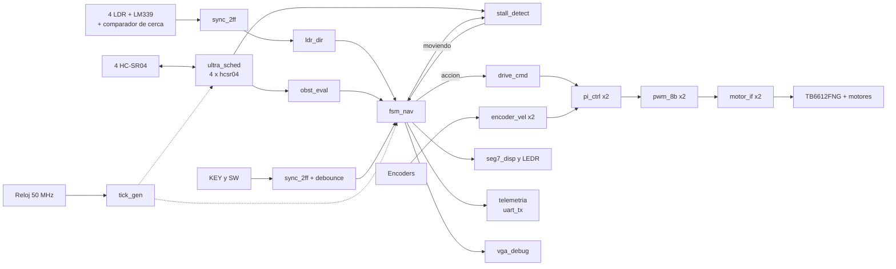
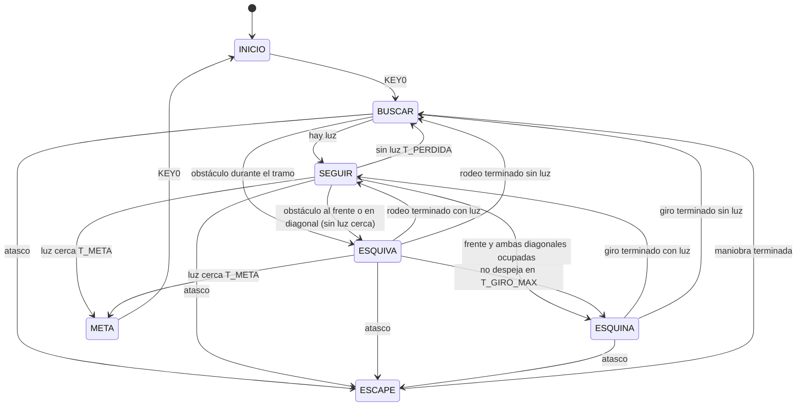

# Arquitectura

## Decisiones de diseño

1. **Un solo reloj.** Todo corre a 50 MHz. Los tiempos lentos (1 µs, 58 µs, 1 ms) salen de pulsos de habilitación de un ciclo generados en `tick_gen`, no de relojes divididos. Así no hay cruces de dominio ni problemas de temporización.
2. **Toda entrada externa pasa por un sincronizador de 2 flip-flops** (LDR, ecos, encoders, botones y switches) antes de usarse.
3. **Parámetros por `generic`:** umbrales de distancia, tiempos de la FSM, velocidades y N del atasco se ajustan en la arena sin reescribir lógica.
4. **Un módulo por archivo, un testbench por módulo** y una prueba de sistema del robot completo con modelos de los sensores.
5. **Puertos solo `std_logic` y `std_logic_vector`**, para que el Block Editor de Quartus genere el símbolo de cada módulo. Las 4 distancias viajan juntas en un vector de 36 bits (sensor `i` en los bits `9i+8` a `9i`). Los códigos de estado, acción y evento tienen nombre en `rtl/robot_pkg.vhd`.
6. **Reset síncrono** desde KEY1 (más un reset de encendido de 16 ciclos). KEY0 arranca y detiene el recorrido.
7. **Cadenas largas en etapas registradas** para cerrar tiempos a 50 MHz: la conversión a decimal de los displays y de la bitácora (multiplicación y double dabble), el tablero VGA (zonas en una etapa, color en otra) y el PI (medida, integrador y corrección en 3 etapas). La latencia extra es de 1 a 3 ciclos, invisible en un display o en un lazo de 50 ms.

## Diagrama de bloques

Guía para el diagrama oficial, que se arma en el Block Editor de Quartus con los símbolos de cada módulo (`File > Create/Update > Create Symbol Files for Current File`, según el manual "Creación y uso de bloques en Quartus").

Con SW2 en 0 (o sin encoders), `pi_ctrl` deja pasar el duty de `drive_cmd` tal cual (lazo abierto).

## Módulos

Todos escritos, con testbench pasando en GHDL y síntesis revisada con `ghdl --synth` (ver `resultados/TAREA-004.md` y `resultados/TAREA-008.md`).

| Módulo | Función | Entradas → salidas principales |
|---|---|---|
| `robot_pkg` | Constantes: códigos de estado, acción, dirección de luz y evento | |
| `tick_gen` | Pulsos de 1 µs, 58 µs y 1 ms | clk → tick_1us, tick_58us, tick_1ms |
| `sync_2ff` | Sincroniza entradas asíncronas (genérico WIDTH) | d → q |
| `debounce` | Filtra botones y switches (20 ms) | raw, tick_1ms → clean, rise, fall |
| `pwm_8b` | PWM de 8 bits a 19.53 kHz; el duty nuevo entra al inicio del periodo | duty(7:0) → pwm |
| `motor_if` | Dirección y enable para el driver, con pausa de 50 ms al invertir el giro | dir, pwm → IN1, IN2, EN |
| `hcsr04` | Un sensor: TRIG de 10 µs, mide ECHO en cm, timeout de 25 ms | start, echo → trig, dist_cm(8:0), valid, timeout |
| `ultra_sched` | Turna los 4 sensores cada 30 ms, sin traslape | echo(3:0) → trig(3:0), dist(35:0), nuevo(3:0), sin_eco(3:0) |
| `ldr_dir` | Filtra las 4 LDR y el comparador de cerca; da la dirección de la luz | ve(3:0), cerca → luz(3:0), dir_luz, hay_luz, luz_cerca |
| `obst_eval` | Distancias → banderas de obstáculo con histéresis; lado más libre | dist(35:0) → obs(3:0), lado_libre |
| `stall_detect` | Atasco: se manda mover pero ninguna distancia válida cambia en 3 s | moviendo, dist, nuevo → atasco |
| `fsm_nav` | FSM principal de 7 estados | luz, obstáculos, atasco, arranque → estado, accion, evento |
| `drive_cmd` | Acción → sentido y duty por rueda, con rampa | accion, habilitado → dir_l, duty_l, dir_r, duty_r |
| `encoder_vel` | Velocidad de una rueda: transiciones por ventana de 50 ms | a, b → vel(9:0), listo |
| `pi_ctrl` | Extra: PI de velocidad con prealimentación y antiwindup | objetivo, medida → duty |
| `seg7_disp` | Estado, evento y % de duty en HEX5 a HEX0; distancia con SW9 | estado, evento, duty, dist → HEX5..HEX0 |
| `uart_tx` | Transmisor UART 8N1 | dato, enviar → tx, ocupado |
| `telemetria` | Bitácora por UART cada 200 ms y en cada evento | estado, evento, dist, luz, duty → tx |
| `vga_debug` | Extra: tablero de 640 × 480 a 60 Hz | estado, sensores, duty → VGA |
| `robot_top` | Integra todo y conecta los pines de la DE10-Lite | |

## FSM principal (`fsm_nav`)

KEY0 también detiene al robot desde cualquier estado (vuelve a INICIO).

| Código (HEX5) | Estado | Qué hace | Acción de motores |
|---|---|---|---|
| 0 | INICIO | Espera KEY0 | PARO |
| 1 | BUSCAR | Gira despacio en su lugar 3 s; si no ve luz y el frente está libre, avanza un tramo de 1.2 s y vuelve a girar | BUSCA, luego AVANZA |
| 2 | SEGUIR | Avanza corrigiendo el rumbo según la LDR que ve luz. Junto a la lámpara (luz cerca y base al frente) se detiene y espera la meta | AVANZA, CURVA, GIRO o PARO |
| 3 | ESQUIVA | Gira hacia el lado libre (lejos de la diagonal ocupada, o hacia la diagonal con más distancia) hasta que el frente y esa diagonal se despejan, mínimo 150 ms; luego avanza 700 ms para rodear | GIRO, luego AVANZA |
| 4 | ESQUINA | Reversa 400 ms si atrás está libre y gira unos 135° (900 ms, se calibra) | REVERSA, luego GIRO |
| 5 | ESCAPE | Reversa 600 ms si atrás está libre y gira hacia un lado al azar (LFSR) entre 0.5 y 1.2 s | REVERSA, luego GIRO |
| 6 | META | Se detiene y parpadean todos los LEDs | PARO |

Eventos (HEX4 y UART): 1 luz encontrada, 2 luz perdida, 3 obstáculo, 4 esquina, 5 atasco, 6 meta.

**Por qué la meta va antes que la evasión:** junto al foco, el sensor del frente ve la base de la lámpara como obstáculo. Si la FSM esquivara, nunca llegaría. Con luz cerca no esquiva; y si ya estaba esquivando, la luz cerca sostenida también cuenta como meta.

### Acciones (`fsm_nav` → `drive_cmd`)

| Acción | Rueda izquierda | Rueda derecha |
|---|---|---|
| PARO | 0 | 0 |
| AVANZA | adelante 170 | adelante 170 |
| CURVA_IZQ / CURVA_DER | adelante 80 / 170 | adelante 170 / 80 |
| GIRO_IZQ / GIRO_DER | atrás 150 / adelante 150 | adelante 150 / atrás 150 |
| REVERSA | atrás 140 | atrás 140 |
| BUSCA | atrás 110 | adelante 110 |

Los duty (de 0 a 255) son generics de `drive_cmd`. El duty sube o baja 8 por ms, y antes de invertir una rueda la rampa la lleva a 0; `motor_if` agrega 50 ms con el motor libre.

### Dirección de la luz (`ldr_dir`)

| LDR con luz | Dirección | Acción en SEGUIR |
|---|---|---|
| frente sola, o frente con izquierda y derecha | FRENTE | AVANZA |
| frente e izquierda | FRENTE_IZQ | CURVA_IZQ |
| frente y derecha | FRENTE_DER | CURVA_DER |
| izquierda (sin derecha) | IZQ | GIRO_IZQ |
| derecha (sin izquierda) | DER | GIRO_DER |
| izquierda y derecha sin frente | FRENTE | AVANZA |
| solo atrás | ATRAS | GIRO_IZQ |
| ninguna | NINGUNA | AVANZA mientras corre T_PERDIDA |

## Interfaz en la tarjeta

| Control | Función |
|---|---|
| KEY0 | Arranca o detiene el recorrido |
| KEY1 | Reset |
| SW1 y SW0 | Sensor que se muestra con SW9 (0 frente, 1 diagonal izq, 2 diagonal der, 3 atrás) |
| SW2 | Control PI con encoders (extra); en 0, lazo abierto |
| SW7 | Prueba de motores: ambas ruedas adelante, sin importar la FSM |
| SW8 | Motores habilitados (STBY del driver). En 0 el robot piensa pero no se mueve: modo banco |
| SW9 | Displays en modo distancia |

| Salida | Muestra |
|---|---|
| HEX5 | Código de estado |
| HEX4 | Último evento |
| HEX3 y HEX2 | % de duty de la rueda izquierda (duty × 100 / 256, de 0 a 99) |
| HEX1 y HEX0 | % de duty de la rueda derecha |
| con SW9 | HEX3 número de sensor (con punto) y HEX2 a HEX0 su distancia en cm; "---" si no hubo eco |
| LEDR0 a LEDR3 | LDR con luz: frente, izquierda, derecha, atrás |
| LEDR4 a LEDR7 | Obstáculo: frente, diagonal izquierda, diagonal derecha, atrás |
| LEDR8 | En ESCAPE (atasco) |
| LEDR9 | Latido de 1 Hz |
| Todos | Parpadean a 4 Hz en META |
| UART (GPIO, 115200 8N1) | Línea `E2 V1 F045 I120 D--- A033 L1010 C0 P66 66 S012 013` cada 200 ms y en cada evento: estado, evento, distancias (frente, diag izq, diag der, atrás), LDR, luz cerca, % de duty y velocidad de los encoders |
| VGA | Banda del color del estado con estado y evento, barras de distancia (verde libre, rojo obstáculo, gris sin eco), cruz de LDR, barras de duty y cuadro de atasco |

## Cálculos clave

- **PWM:** f = 50 MHz / (10 × 256) = 19.53 kHz, arriba de los 18 kHz pedidos, con 8 bits de resolución.
- **HC-SR04:** distancia en cm = tiempo de eco en µs / 58, así que contar periodos de 58 µs da los cm directamente. `hcsr04` arranca su propio contador de 58 µs en el flanco de subida del eco, adelantado medio periodo, y así obtiene round(t/58): un eco de 580 µs da 10 cm exactos. Timeout de 25 ms después del TRIG (unos 4.3 m); sin eco, la distancia sale como 511. Con turnos de 30 ms, los 4 sensores se leen cada 120 ms.
- **Debounce:** 20 ms estables, contados con el tick de 1 ms. Las LDR usan un filtro de 10 ms.
- **Obstáculo:** frente a menos de 25 cm, diagonales a menos de 18 cm, atrás a menos de 12 cm; la bandera baja 5 cm arriba del umbral.
- **Atasco:** mientras la FSM ordena moverse, si en 3 s ninguna distancia válida cambia más de 3 cm. Un eco que aparece y desaparece (511 contra un valor) no cuenta como avance.
- **UART:** 50 MHz / 115200 = 434 ciclos por bit (error de 0.006 %). Una línea de 52 caracteres tarda 4.5 ms.
- **VGA:** 640 × 480 a 60 Hz con pixel de 25 MHz (cada 2 ciclos de 50 MHz): línea de 800 pixeles, cuadro de 525 líneas, sincronías negativas.
- **PI:** la medida se pasa a unidades de duty con `med_duty = medida × 256 / VMAX`; corrección = (4·e + integral) / 16 con integral += 2·e. Es estable si la rueda real da entre la mitad y el doble de VMAX (probado en `tb_pi_ctrl`).
