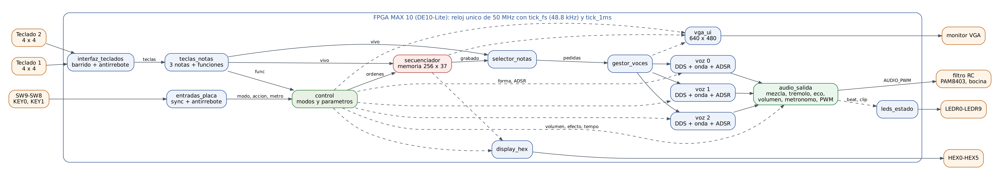
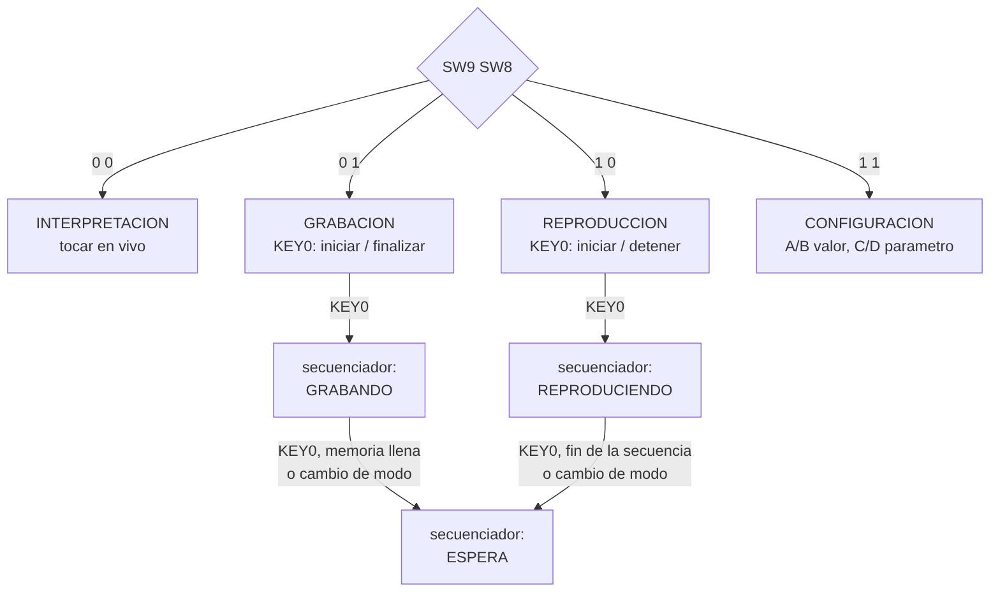
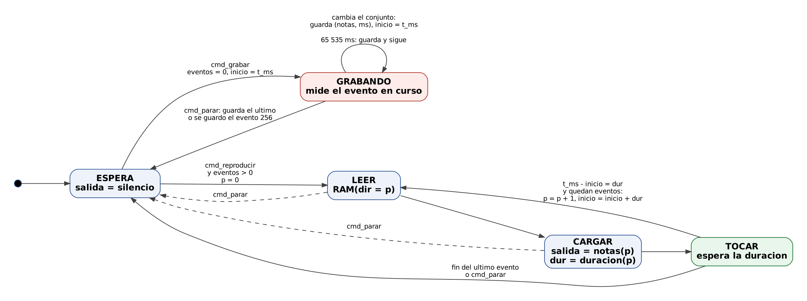
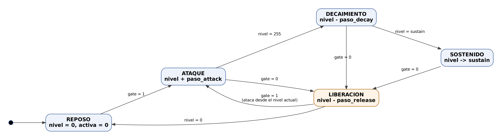
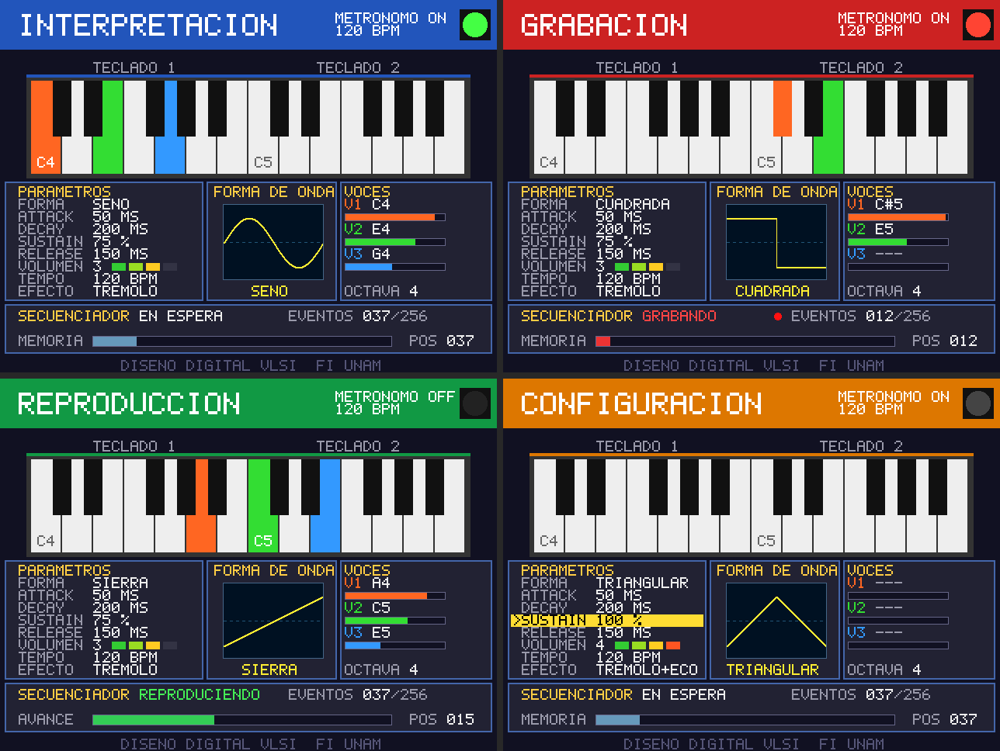

# Arquitectura del sintetizador

## Decisiones de diseño

1. **Un solo reloj de 50 MHz.** Los tiempos lentos salen de pulsos de habilitación de un ciclo de `base_tiempo`: `tick_fs` cada 1024 ciclos (la muestra de audio, Fs = 48 828.125 Hz) y `tick_1ms`. No hay relojes divididos ni cruces de dominio.
2. **Toda entrada externa pasa por un sincronizador de 2 flip-flops** (columnas de los teclados, botones y switches) y después por un antirrebote.
3. **Un módulo por archivo, un testbench por módulo**, más una prueba del sistema completo con modelos de los teclados (ver [PRUEBAS.md](PRUEBAS.md)).
4. **Puertos solo `std_logic` y `std_logic_vector`**, para que Quartus genere el símbolo de cada módulo y el nivel superior sea un diagrama de bloques (`quartus/sintetizador.bdf`), como en el material del curso "Creación y uso de bloques en Quartus". Los códigos de modos, estados, formas de onda y efectos tienen nombre en `rtl/synth_pkg.vhd`.
5. **Los parámetros cambian en operación** (forma de onda, envolvente, volumen, tempo, efecto, octava): son registros de `control`, no constantes; no hace falta volver a sintetizar.
6. **Cadenas largas en etapas registradas**: la multiplicación de cada voz, la cadena de audio (9 ciclos de 1024 disponibles por muestra) y la VGA (3 etapas) cierran tiempos a 50 MHz.

## Diagrama de bloques



El nivel superior existe en dos formas equivalentes, generadas por `tools/genera_top.py` a partir de una sola descripción de la red:

- `quartus/sintetizador.bdf`: diagrama de bloques del Block Editor, nivel superior del proyecto de Quartus.
- `rtl/sinte_top.vhd`: el mismo circuito en VHDL estructural, para simular el sistema completo con GHDL.

| Bloque | Archivo | Función |
|---|---|---|
| Reset de encendido | `reset_encendido.vhd` | `rst` durante los primeros 16 ciclos |
| Base de tiempo | `base_tiempo.vhd` | `tick_fs` (48 828 Hz) y `tick_1ms` |
| Entradas de la tarjeta | `entradas_placa.vhd` | KEY0 y KEY1 a pulsos, SW9-SW8 a modo (sync + antirrebote de 20 ms) |
| Interfaz de teclados | `interfaz_teclados.vhd`, `teclado_scan.vhd` | barrido de los dos teclados 4 × 4, filas en colector abierto, antirrebote de 20 ms por tecla |
| Teclas a notas | `teclas_notas.vhd` | hasta 3 notas presionadas, pulsos de las teclas A-D y última nota |
| Unidad de control | `control.vhd` | modos, parámetros del sonido y órdenes al secuenciador |
| Secuenciador | `secuenciador.vhd`, `memoria_eventos.vhd` | graba y reproduce hasta 256 eventos |
| Selector | `selector_notas.vhd` | notas en vivo o grabadas hacia las voces |
| Gestor de voces | `gestor_voces.vhd` | reparte hasta 3 notas entre 3 voces |
| Voz (× 3) | `voz.vhd`, `dds.vhd`, `forma_onda.vhd`, `adsr.vhd` | DDS, forma de onda, envolvente ADSR y producto |
| Salida de audio | `audio_salida.vhd`, `mezclador.vhd`, `tremolo.vhd`, `eco.vhd`, `volumen.vhd`, `metronomo.vhd`, `salida_pwm.vhd` | mezcla, efectos, volumen, metrónomo y PWM |
| Displays | `display_hex.vhd` | modo, octava, nota, eventos y parámetros en HEX0-HEX5 |
| VGA | `vga_ui.vhd`, `fuente_5x7.vhd` | pantalla de 640 × 480 con el estado completo |
| LEDs | `leds_estado.vhd` | voces, metrónomo, grabación, reproducción, efectos y saturación |

## Entradas

### Teclados

Dos teclados de membrana 4 × 4. Las tres primeras columnas tocan notas en orden cromático y la cuarta son funciones:

```
 1  2  3  A        C   C#  D   | A
 4  5  6  B   ->   D#  E   F   | B
 7  8  9  C        F#  G   G#  | C
 *  0  #  D        A   A#  B   | D
```

El teclado 1 toca la octava base (2 a 6, inicia en 4) y el teclado 2 la siguiente: **dos octavas cromáticas completas** a la vez, y con las teclas de octava se recorre de C2 a B7.

`teclado_scan` activa una fila por milisegundo en los dos teclados a la vez (`'0'` en la fila activa, alta impedancia en las demás) y lee las 8 columnas, que tienen pull-up. Cada una de las 32 teclas tiene su propio antirrebote: cambia de estado tras 5 lecturas seguidas iguales (20 ms). Como el teclado no tiene diodos, tres teclas en esquinas de un rectángulo producen una cuarta fantasma; con acordes de 3 notas de teclados distintos o filas distintas no pasa.

`teclas_notas` convierte el estado de las teclas en:

- `notas`: hasta 3 notas pedidas, de grave a aguda (7 bits cada una, `n = 12 · octava + semitono`, A4 = 57, 0 = vacía). Con más de 3 teclas se quedan las 3 más graves.
- `func`: pulso de un ciclo al presionar A, B, C o D de cada teclado.
- `ultima`: la última nota presionada, para los displays.

### Botones y switches

| Control | Función |
|---|---|
| SW9-SW8 | modo: 00 interpretación, 01 grabación, 10 reproducción, 11 configuración |
| KEY0 | en grabación inicia o finaliza; en reproducción inicia o detiene |
| KEY1 | enciende o apaga el metrónomo |

## Unidad de control



`control` guarda los parámetros y decide qué hace cada tecla de función según el modo:

| Tecla | Interpretación, grabación y reproducción | Configuración |
|---|---|---|
| Teclado 1, A / B | octava − / + (2 a 6) | valor − / + del parámetro elegido |
| Teclado 1, C | siguiente forma de onda | parámetro anterior |
| Teclado 1, D | siguiente efecto | parámetro siguiente |
| Teclado 2, A / B | volumen − / + (0 a 4) | valor − / + |
| Teclado 2, C / D | tempo − / + | parámetro anterior / siguiente |

Parámetros (en configuración se recorren en este orden):

| # | Parámetro | Valores (0 a 3, o 0 a 4) | Inicial |
|---|---|---|---|
| 0 | Forma | cuadrada, triangular, sierra, seno | cuadrada |
| 1 | Attack | 2, 50, 200, 800 ms | 2 ms |
| 2 | Decay | 50, 200, 600, 1500 ms | 200 ms |
| 3 | Sustain | 25, 50, 75, 100 % | 75 % |
| 4 | Release | 20, 150, 500, 1500 ms | 150 ms |
| 5 | Volumen | silencio, 25, 50, 75, 100 % | 75 % |
| 6 | Tempo | 60, 90, 120, 150 BPM | 120 BPM |
| 7 | Efecto | ninguno, trémolo, eco, los dos | ninguno |

Attack, decay y release son tiempos de escala completa (de 0 a 255 o al revés); sustain es un nivel. En configuración los valores se quedan en sus límites; con las teclas directas, forma y efecto dan la vuelta.

Órdenes al secuenciador: KEY0 en grabación manda `cmd_grabar` (si está en espera) o `cmd_parar` (si graba); en reproducción, `cmd_reproducir` o `cmd_parar`. Cambiar de modo a mitad de una grabación o reproducción también manda `cmd_parar`. El metrónomo suena en interpretación y grabación y se calla mientras se reproduce una secuencia.

## Secuenciador y memoria

Un **evento** es un conjunto de notas que se mantuvo igual (hasta 3 notas, o silencio si no hay ninguna) y su duración en milisegundos. Así quedan grabadas notas, acordes y silencios con sus duraciones, en orden.

Formato de cada palabra de `memoria_eventos` (RAM de 256 × 37 bits, 2 bloques M9K):

| Bits | Contenido |
|---|---|
| 36..30 | nota 3 (0 = vacía) |
| 29..23 | nota 2 |
| 22..16 | nota 1 |
| 15..0 | duración en ms (1 a 65 535) |

Capacidad: 256 eventos (la especificación pide 64). Un evento de más de 65.5 s se guarda como dos.



- **ESPERA**: salida en silencio. `cmd_grabar` borra la secuencia anterior y pasa a GRABANDO; `cmd_reproducir` con eventos guardados pasa a LEER.
- **GRABANDO**: cuando cambia el conjunto de notas, guarda el evento que termina (notas y ms) y empieza a medir el siguiente. `cmd_parar` guarda el último y vuelve a ESPERA; al guardar el evento 256 (memoria llena) también.
- **LEER → CARGAR → TOCAR**: lee el evento, pone sus notas en la salida y espera su duración; luego el siguiente. Después del último, la salida queda en silencio y regresa a ESPERA.

La base de tiempo del secuenciador es un contador libre de milisegundos (`t_ms`); `inicio` guarda el milisegundo en que empezó el evento actual y la duración es `t_ms - inicio`. Al reproducir, el evento siguiente empieza en `inicio + duración`, así la latencia de la máquina (2 ciclos por evento) no pierde ticks ni acumula error: la reproducción dura exactamente lo que la grabación (verificado en simulación).

En reproducción las voces toman las notas del secuenciador (`selector_notas`); lo que se toque encima no suena. Los parámetros del sonido sí se pueden cambiar mientras se reproduce.

## Generación de audio

### Voces

Hay **3 voces independientes** (polifonía), cada una con su DDS y su ADSR:

```
nota -> ROM de incrementos -> DDS (24 bits) -> forma_onda --+
                                                             x -> muestra (8 bits con signo)
gate ------------------------------> ADSR (24 bits) --------+
```

**DDS.** Un acumulador de fase de 24 bits suma un incremento en cada muestra: `fase = fase + inc (mod 2^24)`. La frecuencia es `f = inc · Fs / 2^24`, con resolución de 0.0029 Hz. Los incrementos de las 12 notas de la octava 7 están en `synth_pkg` (`inc = f · 2^24 / Fs`, por ejemplo B7: 3951.07 Hz → 1 357 576); las octavas de abajo se obtienen dividiendo entre 2 por octava. Con eso se arma una ROM de 128 incrementos. El error máximo contra la afinación temperada (A4 = 440 Hz) es menor a 0.01 %. Cambiar de nota solo cambia el incremento; la fase sigue sin saltos.

**Formas de onda** (de los bits altos de la fase, sin memoria salvo el seno):

| Forma | Cálculo |
|---|---|
| Cuadrada | +127 si `fase(23) = 0`, −127 si no |
| Triangular | `fase(22..15) − 128` subiendo en la primera mitad, `127 − fase(22..15)` bajando en la segunda |
| Sierra | `fase(23..16) − 128` |
| Seno | tabla de 256 puntos indexada con `fase(23..16)` |

**Envolvente ADSR.** Acumulador de 24 bits; el nivel son sus 8 bits altos (0 a 255). Avanza una vez por muestra con un paso por etapa: para recorrer la escala completa en T ms, `paso = 2^24 / (T · Fs / 1000) = 343 597 / T`.



Al soltar la nota en cualquier etapa pasa a LIBERACIÓN desde el nivel actual; si se vuelve a presionar durante la liberación, ataca desde ese nivel (sin regresar a 0, sin chasquido). Si el sustain cambia mientras se sostiene una nota, el nivel va al nuevo valor con la pendiente del decay.

**Producto.** `muestra = onda · nivel / 256`, en un multiplicador embebido de 9 bits.

### Gestor de voces

Cada ciclo suelta (gate = 0) toda voz cuya nota ya no se pide, conservando la nota para que la liberación suene a la misma frecuencia, y asigna la primera nota pedida sin voz a una voz libre con esta preferencia: la que ya tenía esa nota (se volvió a presionar durante su liberación), una en reposo, o cualquiera libre. Con 3 voces y máximo 3 notas, siempre hay voz para cada nota. Un acorde completo queda repartido en 3 ciclos (60 ns).

### Cadena de salida (`audio_salida`)

```
voz0..2 -> mezclador -> trémolo -> eco -> volumen -> (+ clic del metrónomo) -> PWM
```

Formato interno de 12 bits con signo (la muestra de 8 bits con 4 bits de fracción, escala completa ±2032). Todo avanza con `tick_fs`; la muestra final está lista 9 ciclos después y el PWM la toma al empezar su siguiente periodo.

| Etapa | Funcionamiento |
|---|---|
| Mezclador | `(voz0 + voz1 + voz2) / 2` con saturación; una voz a escala completa da media escala y solo un acorde de 3 voces en fase llega a saturar |
| Trémolo | LFO triangular de 4.98 Hz; la ganancia va de 1.0 a 0.5 |
| Eco | `y[n] = x[n] + y[n − 8192] / 2` con saturación: el eco llega 168 ms después y cada repetición vale la mitad. RAM de 8192 × 12 bits en bloques M9K |
| Volumen | `y = x · vol / 4`, vol de 0 (silencio) a 4 (100 %), con corrimientos y sumas |
| Metrónomo | clic cuadrado de 2 kHz (3 kHz en el acento) de 24.7 ms con caída lineal; no pasa por el volumen ni por los efectos, para que se distinga de las notas |
| PWM | 8 bits a 195.3 kHz (`50 MHz / 256`), ciclo de trabajo = muestra + 128 |

`clip` se enciende 100 ms cuando alguna etapa satura (LEDR9).

### Metrónomo

Cuenta milisegundos y marca un tiempo cada 1000, 667, 500 o 400 ms (60, 90, 120, 150 BPM), con acento en el primero de cada 4. Al encenderlo, el primer tiempo es inmediato. Es independiente de las voces: tiene su propio generador del clic y se suma al final de la cadena. El tiempo se ve en LEDR4 y en la VGA (verde, rojo en el acento).

### Etapa analógica

El PWM sale por el pin 31 del header a un filtro RC de dos etapas (1 kΩ y 10 nF cada una, −3 dB en unos 6 kHz y −44 dB a 195 kHz), un capacitor de 10 µF que quita la DC, un divisor de 1/11 y el amplificador PAM8403, que mueve una bocina de 8 Ω. Detalle en [CABLEADO.md](CABLEADO.md).

## Interfaz de usuario

### Displays (HEX5 a HEX0)

| Modo | HEX5-HEX4 | HEX3-HEX0 |
|---|---|---|
| Interpretación | `In` | `o` + octava base, y la última nota (letra y octava; el punto indica sostenido: `C.5` = C#5) |
| Grabación | `Gr` | eventos grabados |
| Reproducción | `rP` | número del evento que suena (eventos guardados en espera) |
| Configuración | `CF` | parámetro (`Fo`, `At`, `dE`, `Su`, `rE`, `Uo`, `tE`, `EF`) y su valor |

### LEDs

LEDR0-2 voces sonando, LEDR3 metrónomo encendido, LEDR4 tiempo del metrónomo, LEDR5 grabando, LEDR6 reproduciendo, LEDR7 memoria llena, LEDR8 efecto activo, LEDR9 saturación.

### VGA (640 × 480 a 60 Hz)



`vga_ui` dibuja con pixel de 25 MHz y una tubería de 3 etapas; las entradas se copian una vez por cuadro, así nunca se ve un cuadro partido:

- Banda superior con el nombre del modo (color por modo), estado del metrónomo, tempo en BPM y un foco que destella en cada tiempo.
- Piano de dos octavas desde la octava base; las teclas que suenan se pintan del color de su voz.
- Panel de parámetros (en configuración se resalta el elegido), dibujo de un periodo de la forma de onda elegida y panel de voces con la nota y una barra del nivel de su envolvente.
- Secuenciador: estado, eventos guardados (n/256), barra de avance o de memoria usada y posición.

## Recursos y tiempos

Se llenan con la compilación de Quartus en la PC del laboratorio (`quartus/compilar.sh`); ver [PRUEBAS.md](PRUEBAS.md#compilación-en-quartus).

## Limitaciones conocidas

- Polifonía de 3 notas: con más teclas presionadas se quedan las 3 más graves.
- Teclado sin diodos: tres teclas en esquinas de un rectángulo del mismo teclado agregan una cuarta fantasma.
- El secuenciador guarda las notas, no los cambios de parámetros: la reproducción usa la forma, envolvente, volumen y efecto que estén en ese momento.
- La reproducción no se mezcla con lo que se toque en vivo.
- PWM de 8 bits: el ruido de cuantización es audible a volumen muy bajo; el filtro RC de 2 etapas deja pasar algo del armónico de 195 kHz, que la bocina no reproduce.
