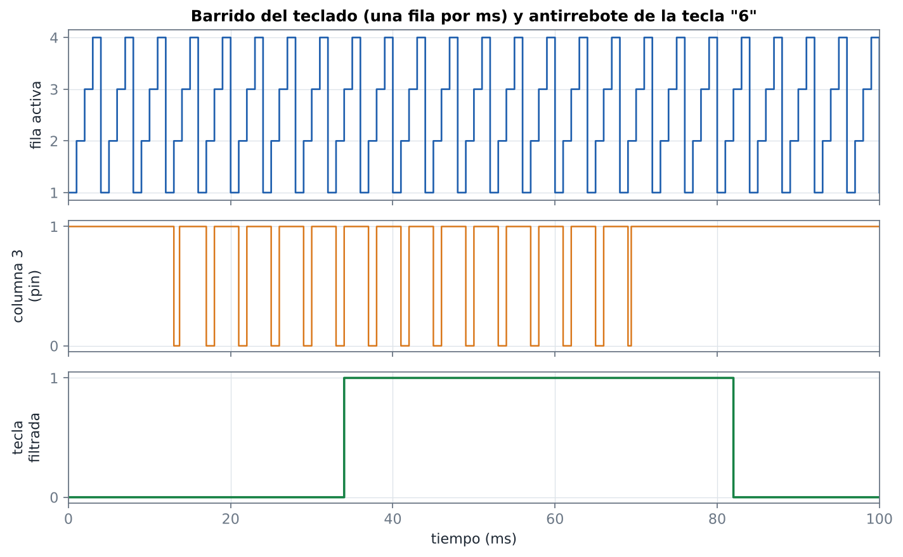
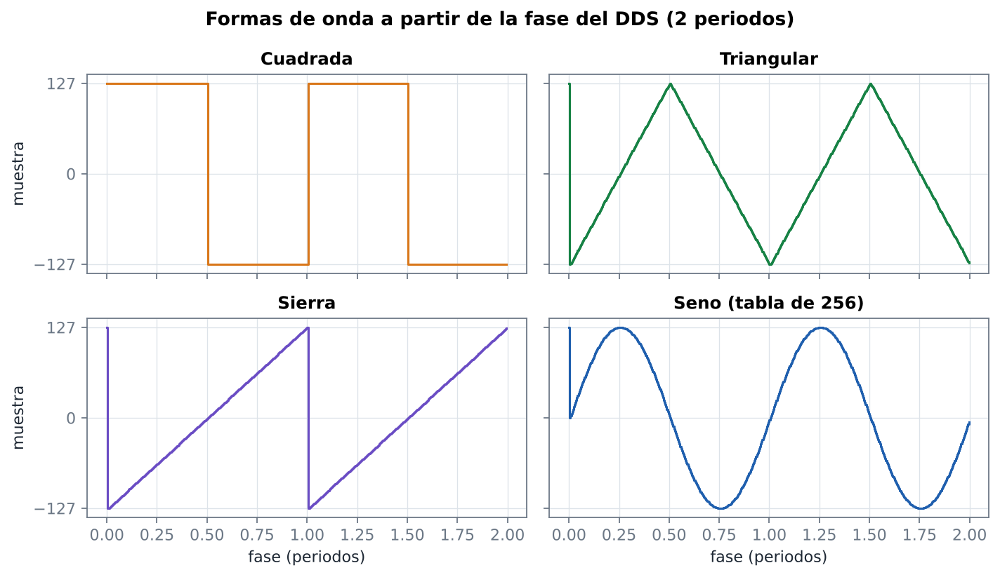
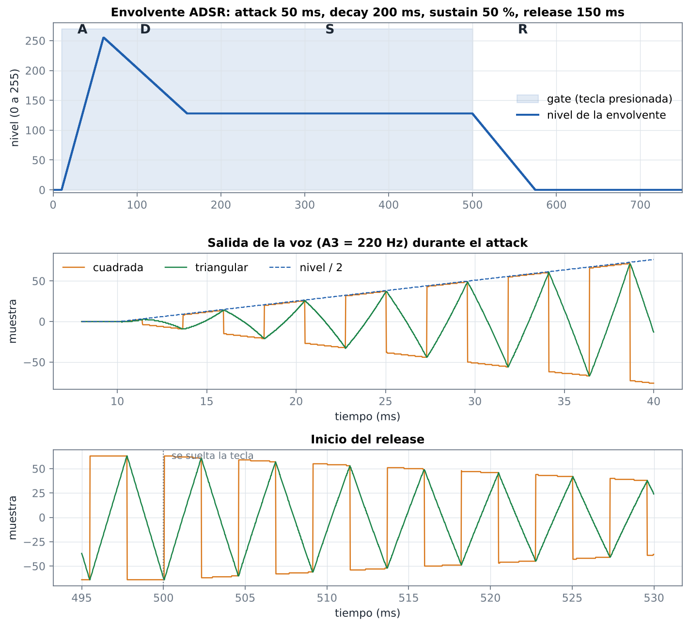
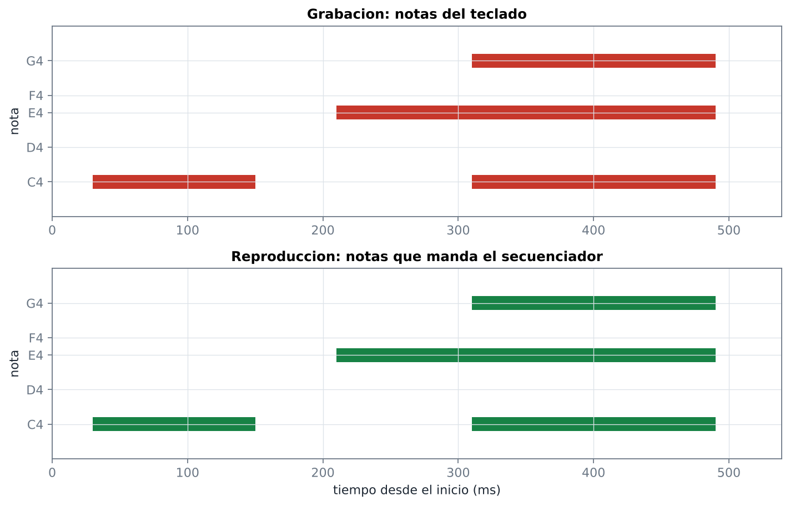
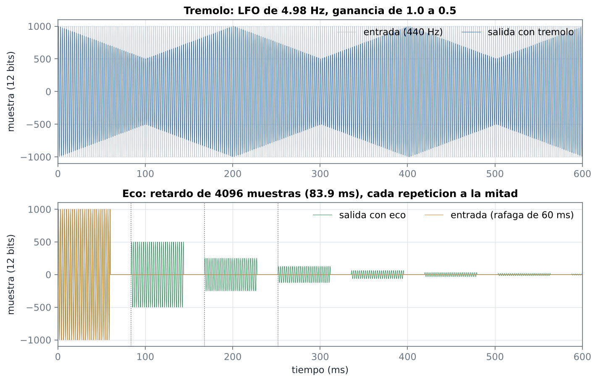
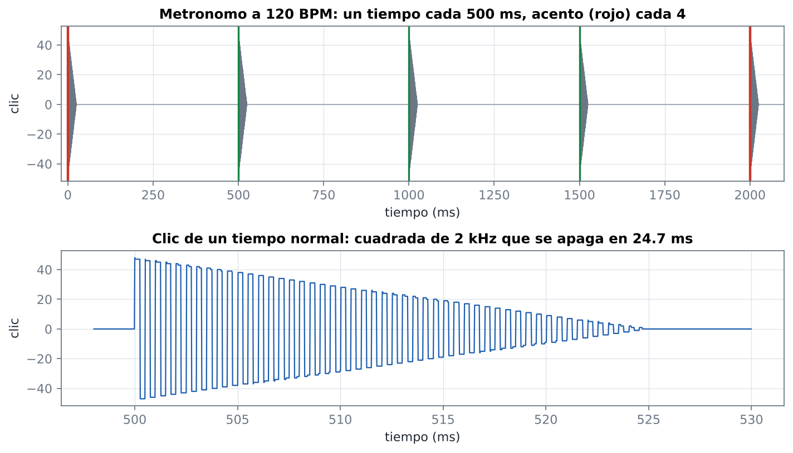
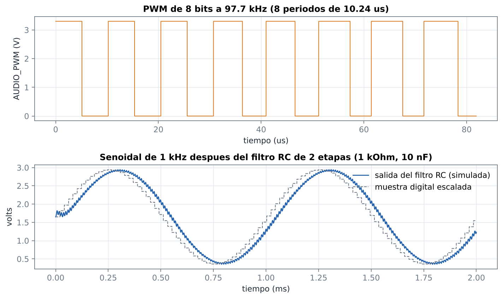

# Pruebas

## Simulación (GHDL)

Cada módulo de `rtl/` tiene su testbench en `sim/` y además hay una prueba del sistema completo. Todos verifican con `assert ... severity error` (no basta con ver ondas) y terminan con `report "tb_<modulo>: OK"`.

```bash
sh sim/correr.sh                  # todos los testbenches
sh sim/correr.sh secuenciador     # uno solo
```

| Testbench | Qué revisa |
|---|---|
| `tb_base_tiempo` | a 25 MHz: `tick_fs` cada 512 ciclos y `tick_1ms` cada 1 ms exactos, pulsos de un ciclo, reset a mitad de cuenta |
| `tb_reset_encendido` | `rst` en alto mientras el PLL no se engancha; baja a los 18 flancos del enganche; el botón RESET lo sube mientras está presionado; se vuelve a subir si el PLL se desengancha |
| `tb_sync_2ff`, `tb_debounce` | sincronizador de 2 flip-flops; rebotes de 2 ms y un pulso de 15 ms se filtran, un nivel estable pasa entre 19 y 20 ms |
| `tb_entradas_placa` | ACCIÓN y METRÓNOMO dan un solo pulso entre 19 y 21 ms después de presionar; MODO recorre los 4 modos una vez por pulsación (mantenerlo no avanza); rebotes de 5 ms rechazados; reset regresa a interpretación |
| `tb_teclado_scan` | una sola fila activa en orden; tiempo de antirrebote en las 4 fases del barrido; rebotes rechazados; las 32 teclas en su bit; varias teclas a la vez; reset |
| `tb_interfaz_teclados` | con modelos de teclado en los pines: filas solo en `'0'` o `'Z'`, las 32 teclas, dos teclas de la misma columna |
| `tb_teclas_notas` | las 24 teclas de nota en las octavas 2 a 6; pulsos de un ciclo de las 8 teclas de función; las 3 notas más graves en orden; al soltar regresa la siguiente; cambio de octava con teclas presionadas |
| `tb_dds` | fase = N · inc; no avanza sin `tick_fs`; cambio de incremento sin saltos; A4 da 440 vueltas en un segundo; afinación de las notas 24 a 95 con error menor a 0.1 % |
| `tb_forma_onda` | las 4 formas en 65 536 fases: rango, cuadrada, triangular contra la ideal (±2), sierra creciente, seno contra `sin` (±1); cambio de forma en operación (2 ciclos de latencia) |
| `tb_adsr` | los 4 tiempos de attack, de decay hasta los 4 sustain y de release (±2 %); soltar a mitad del attack; volver a presionar en el release sin caer a 0; cambio de sustain en operación |
| `tb_voz` | periodo de A4 (110.97 muestras); amplitud con sustain 255 y 128; cambio de nota y de forma sin soltar; voz inactiva da 0; la nota 0 no suena |
| `tb_gestor_voces` | reparto de notas, soltar, reuso de la voz en liberación, preferencia por voces en reposo, acorde que cambia completo y 20 000 conjuntos al azar con invariantes |
| `tb_selector_notas` | notas en vivo en espera y grabando; grabadas al reproducir |
| `tb_secuenciador` | grabación con notas, acordes y silencios con duraciones exactas; reproducción con el mismo orden y duración; posición; detener; eventos de 0 ms; memoria llena (256); nota de más de 65.5 s; cambios en el mismo ciclo que un tick |
| `tb_control` | valores iniciales; octava, forma, efecto, volumen y tempo con sus límites; recorrido de parámetros en configuración; metrónomo; órdenes de ACCIÓN según el modo; parar al cambiar de modo |
| `tb_mezclador`, `tb_tremolo`, `tb_eco`, `tb_volumen`, `tb_metronomo`, `tb_salida_pwm`, `tb_audio_salida` | etapa de audio: mezcla y saturación exactas, LFO de 4.98 Hz, eco a 4096 muestras con mitad de amplitud, los 5 niveles de volumen, periodos de 60 a 150 BPM con acento cada 4, PWM bit a bit y la cadena completa |
| `tb_leds_estado` | D4 solo grabando, D5 solo reproduciendo, destello de 100 ms en D2 solo con el metrónomo encendido, LEDs activos en bajo |
| `tb_vga_ui` | sincronías de 640 × 480 a 60 Hz con pixel de 25 MHz y contenido de la pantalla con la paleta de 8 colores |
| `tb_sinte_top` | sistema completo desde el reloj de 50 MHz (con el modelo del PLL) y dos modelos de teclado: A4 = 440 Hz medido en el PWM, acorde de 3 voces, A5 y A6 en los dos teclados, configuración con el botón MODO y los teclados (forma triangular y release), grabación y reproducción con la misma duración (LEDs D4 y D5), metrónomo (D2 y clic) y sincronías VGA |

### Resultado de la última corrida

9 de noviembre de 2026, GHDL 4.1.0, con el diseño para la EP2C5T144: **los 26 testbenches pasan** ([logs/sim_modulos.log](../logs/sim_modulos.log) y [logs/sim_sinte_top.log](../logs/sim_sinte_top.log)).

- La prueba del sistema simula 3.39 s de operación desde el reloj de 50 MHz y mide la frecuencia en la salida de audio con tolerancia de 0.5 %: A4 = 440 Hz, A5 = 880 Hz, A6 = 1760 Hz en el teclado 2, A4 en triangular y C4 = 261.63 Hz al reproducir. La reproducción dura lo mismo que la grabación (±2 ms) y los LEDs D2, D4 y D5 se encienden solo cuando deben.
- `ghdl --synth` del diseño completo (con el modelo del PLL en lugar del `altpll`) termina sin errores y sin latches; los avisos son atributos que solo usa Quartus (`romstyle`, `altera_attribute`) y las tablas que se leen de su valor inicial ([logs/ghdl_synth.log](../logs/ghdl_synth.log)).

### Pruebas de mutación

Para saber si los testbenches de verdad detectan errores, se metieron errores a propósito en copias del código (por ejemplo: antirrebote de 4 lecturas en vez de 5, un incremento de nota equivocado, release con el paso del decay, una voz que no se suelta, eventos de 0 ms guardados, octava máxima de 7, un botón que avanza dos modos, un LED encendido en el modo equivocado, eco a 4095 muestras, un sincronismo VGA de 95 pixeles) y se corrió el testbench de cada módulo. Cada error tiene que hacer fallar su testbench por un `assert` o un error en tiempo de ejecución; un error que deja de compilar no cuenta.

| Grupo | Mutaciones | Detectadas |
|---|---|---|
| Núcleo: teclados, voz, gestor de voces, secuenciador, control, botones, LEDs, reset, base de tiempo | 48 | 48 |
| Audio: mezclador, trémolo, eco, volumen, metrónomo, PWM y cadena completa | 35 | 35 |
| VGA | 58 | 58 |
| **Total** | **141** | **141** |

Corrida del 9 de noviembre de 2026, ya con el diseño para la EP2C5T144.

Cada mutación con el mensaje con el que falló su testbench: [logs/mutacion.log](../logs/mutacion.log).

### Gráficas de simulación

`sh sim/graficas/genera.sh` corre las simulaciones de `sim/graficas/` y dibuja estas gráficas (las usa el reporte):

| Gráfica | Contenido |
|---|---|
|  | barrido de filas, columna con rebotes y tecla filtrada |
|  | las 4 formas de onda generadas desde la fase del DDS |
|  | envolvente ADSR completa y salida de la voz en el attack y el release |
|  | una melodía con acorde grabada y reproducida |
|  | trémolo y eco |
|  | tiempos a 120 BPM con acento y forma del clic |
|  | PWM y señal después del filtro RC |

## Compilación en Quartus

```bash
sh quartus/compilar.sh
```

Con Quartus II 13.0 SP1 (la última versión que soporta Cyclone II). Crea el proyecto para la EP2C5T144C8 (`crear_proyecto.tcl`), compila y muestra el resumen de recursos y la Fmax del reloj de 25 MHz. Si el diagrama de bloques diera problemas, `sh quartus/compilar.sh sinte_top` compila el mismo circuito con el nivel superior en VHDL (`rtl/sinte_top.vhd`).

`sh quartus/estimar_recursos.sh` estima los elementos lógicos con un Quartus Prime más nuevo (compila para una Cyclone IV E, que usa el mismo elemento lógico de 4 entradas) mientras no se tenga la 13.0 SP1.

Estado: pendiente (TAREA-017 estimación, TAREA-019 compilación); los resultados quedan en `resultados/`. La compilación anterior para la DE10-Lite está en `resultados/TAREA-013.md`.

## Pruebas en la tarjeta

Con la tarjeta programada (`sh quartus/programar.sh`), el monitor VGA conectado y todo armado según [CABLEADO.md](CABLEADO.md). En cada paso, lo que se debe ver u oír:

| # | Acción | Resultado esperado |
|---|---|---|
| 1 | Encender la tarjeta (o presionar RESET) | LEDs D2, D4 y D5 apagados; VGA con la banda azul INTERPRETACION, octava 4, voces vacías |
| 2 | Presionar cada tecla de nota del teclado 1 | suena; la tecla se pinta en el piano de la VGA (de C4 a B4) y su nota aparece en VOCES |
| 3 | Lo mismo en el teclado 2 | una octava arriba (C5 a B5) |
| 4 | Acorde de 3 teclas | 3 teclas de colores distintos (rojo, verde, cian) en el piano y 3 barras de nivel en VOCES |
| 5 | A y B del teclado 1 | la octava (VOCES, abajo) baja y sube entre 2 y 6 y el piano cambia sus etiquetas |
| 6 | C del teclado 1 con una nota sostenida | cambia la forma de onda (cuadrada, triangular, sierra, seno); se oye distinto y la VGA la dibuja |
| 7 | A y B del teclado 2 | volumen de 0 (silencio) a 4; el medidor de VOLUMEN cambia |
| 8 | Botón METRÓNOMO | D2 destella en cada tiempo y se oye el clic (más agudo cada 4 tiempos); la VGA muestra METRONOMO ON y el foco destella |
| 9 | C y D del teclado 2 | tempo de 60 a 150 BPM |
| 10 | D del teclado 1 | efecto: trémolo (el volumen ondula), eco (repeticiones cada 84 ms), los dos, ninguno |
| 11 | MODO 3 veces (configuración) | banda magenta CONFIGURACION y el renglón FORMA resaltado; C y D recorren los parámetros; A y B cambian el valor; probar attack de 800 ms y release de 1.5 s |
| 12 | MODO una vez (interpretación) y otra (grabación); ACCIÓN, tocar una melodía con un silencio y un acorde, ACCIÓN | banda roja; D4 encendido mientras graba; EVENTOS cuenta |
| 13 | MODO (reproducción), ACCIÓN | banda verde; D5 encendido; suena la melodía igual; la barra AVANCE y POS avanzan; al terminar D5 se apaga y queda EN ESPERA |
| 14 | ACCIÓN a mitad de una reproducción | se detiene en silencio |
| 15 | Grabar más de 256 eventos (presionar y soltar muchas veces) | se detiene sola en 256/256 |
| 16 | RESET de la tarjeta | regresa al paso 1 |

## Guion de la demostración

1. Arquitectura en dos minutos: diagrama de bloques (`quartus/sintetizador.bdf` en Quartus o [ARQUITECTURA.md](ARQUITECTURA.md)), un solo reloj de 25 MHz del PLL con pulsos de habilitación, DDS + ADSR por voz, y cómo se ajustó a la EP2C5 (tablas en memoria M4K, búsqueda de notas en serie).
2. Interpretación: escala cromática en los dos teclados (dos octavas), cambio de octava, acorde de 3 notas (polifonía).
3. Formas de onda: la misma nota en cuadrada y triangular (y sierra y seno).
4. ADSR: en configuración, attack largo y release largo; luego sustain bajo.
5. Volumen: de 4 a 0 (silencio) y de regreso.
6. Metrónomo: encenderlo, cambiar tempo, notar el acento cada 4.
7. Grabación y reproducción: una melodía corta con un silencio y un acorde; reproducirla; detenerla a la mitad; reproducirla completa y ver que regresa a espera.
8. Efectos: trémolo y eco sobre notas sostenidas.
9. VGA: recorrer la pantalla (modo, piano, parámetros, forma de onda, voces, secuenciador).
10. Preguntas: tener a la mano [ARQUITECTURA.md](ARQUITECTURA.md) (FSM del ADSR y del secuenciador, organización de la memoria, cálculo de los incrementos y de los pasos del ADSR).
